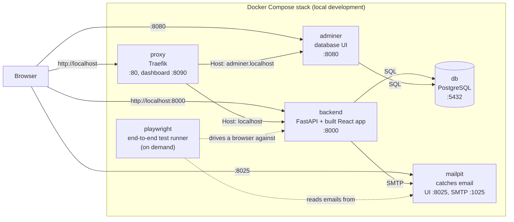
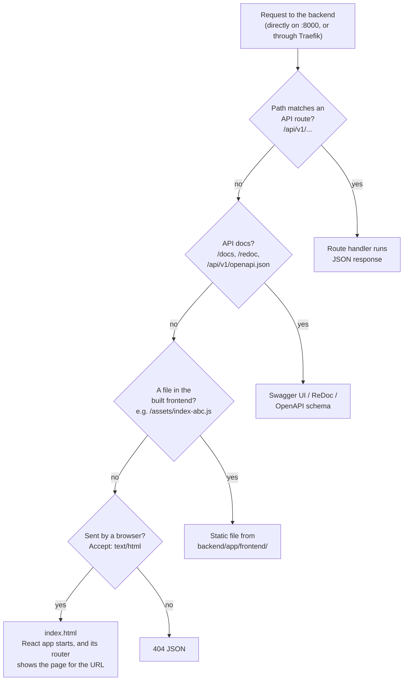
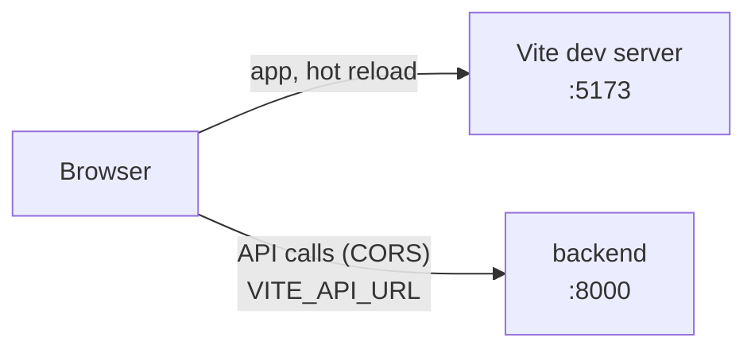
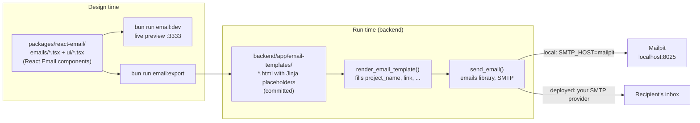

# Architecture

How the pieces of this application fit together: which services run, how a request travels through them, and where each part lives in the repository. More diagrams (database schema, authentication, password reset, CI/CD, deployments) are in [docs/diagrams.md](./docs/diagrams.md).

## The Big Picture

It's a single web application: a **FastAPI** backend that serves both the JSON API and the **React** frontend, backed by **PostgreSQL**. The frontend is compiled to static files ahead of time, so there's no separate frontend server in production. Everything runs as Docker Compose services.



| Service | Image or build | Role | Local port(s) |
|---|---|---|---|
| `proxy` | `traefik:v3.7` | Reverse proxy. Routes requests to services by hostname, using Docker labels. In deployments it also handles HTTPS. | 80, 8090 (dashboard) |
| `db` | `postgres:18` | The database. Data lives in the `app-db-data` volume. | 5432 |
| `adminer` | `adminer` | Web UI for browsing and editing the database | 8080 |
| `backend` | `backend/Dockerfile` | FastAPI app: the API, the API docs, and the built frontend | 8000 |
| `mailpit` | `axllent/mailpit` | Catches outgoing email so you can read it. Local only. | 8025 (UI), 1025 (SMTP) |
| `playwright` | `frontend/Dockerfile.playwright` | Runs the end-to-end tests in a real browser. Exits immediately unless given a test command. Local only. | 9323 (report) |

The services are defined in three Compose files:

* **`compose.yml`:** the base definition shared by all environments. Services, the database volume, health checks, and Traefik routing labels.
* **`compose.override.yml`:** local development additions, which Compose loads automatically. Published ports, the backend in `fastapi dev` mode with `docker compose watch` support, `FASTAPI_ENV=development`, SMTP pointed at Mailpit, the `mailpit` and `playwright` services, and the Traefik dashboard.
* **`compose.deploy.yml`:** used *instead of* the override on a server (`docker compose -f compose.yml -f compose.deploy.yml ...`). HTTPS on port 443 with automatic Let's Encrypt certificates, an HTTP to HTTPS redirect, and `restart: always`. No Mailpit, no test runner, no published database port.

## How a Request Is Handled

The backend is the only service a user's browser needs. One FastAPI process answers three kinds of requests:



* **API routes** are defined in `backend/app/api/routes/`, mounted under `/api/v1`: `login`, `users`, `items`, `utils`, and, only when `FASTAPI_ENV=development`, `private`, which is used by the tests.
* **The frontend** is served by `app.frontend("/", directory=FRONTEND_DIR)` in `backend/app/main.py`. Because unmatched browser requests get `index.html`, deep links such as `/items` or `/settings` work on reload: the browser receives the app, and TanStack Router renders the right page.
* **The frontend calls the API on the same origin** (`/api/v1/...`). Only the Vite development server needs `VITE_API_URL` to point it at the backend on another port.

### In local development with the Vite server

For fast frontend work, you can run the Vite dev server on your machine (`bun run dev`, port 5173) instead of using the built frontend. The browser then loads the app from Vite and calls the API on `:8000` directly. That's a cross-origin request, so the backend allows it with CORS for exactly one origin, `FRONTEND_HOST` (`http://localhost:5173` by default).



## Backend

FastAPI on Python 3.14, managed with uv.

| Path | What's there |
|---|---|
| `backend/app/main.py` | Creates the app: CORS, the API router, the frontend, and Sentry (when `SENTRY_DSN` is set and not in development) |
| `backend/app/api/main.py` | Collects the routers under `/api/v1` |
| `backend/app/api/routes/` | One module per area: `login.py`, `users.py`, `items.py`, `utils.py`, `private.py` |
| `backend/app/api/deps.py` | Shared dependencies: database session, current user from the token, superuser check |
| `backend/app/core/config.py` | All settings, loaded from environment variables and the root `.env` (pydantic-settings) |
| `backend/app/core/db.py` | Database engine, created from `DATABASE_URL`, and first-superuser creation |
| `backend/app/core/security.py` | Password hashing and JWT creation |
| `backend/app/models.py` | SQLModel models: database tables and API schemas |
| `backend/app/crud.py` | Database helpers: create users, authenticate, create items |
| `backend/app/utils.py` | Email rendering and sending, password-reset tokens |
| `backend/app/alembic/` | Database migrations |
| `backend/app/email-templates/` | Generated email HTML (see [Email](#email)) |
| `backend/app/initial_data.py` | Creates the first superuser |
| `backend/scripts/prestart.sh` | Runs migrations, then `initial_data.py`. Run before starting the app, and by the deploy workflows. |
| `backend/tests/` | pytest tests, against a real database |

**Database access:** SQLModel (SQLAlchemy plus Pydantic) with the psycopg 3 driver. The connection is configured by a single `DATABASE_URL`. Docker Compose builds it as `postgresql://postgres:<POSTGRES_PASSWORD>@db:5432/app`; for local runs it comes from `.env`. A `postgres://` or `postgresql://` URL is switched to the psycopg driver automatically. The schema is changed only through Alembic migrations (`alembic upgrade head` in `prestart.sh`).

### Authentication

* **Login:** OAuth2 password flow. The frontend posts the email and password to `/api/v1/login/access-token` and receives a JWT access token.
* **Tokens:** HS256-signed with `SECRET_KEY`, valid for 8 days (`ACCESS_TOKEN_EXPIRE_MINUTES`), containing the user's ID. The frontend keeps the token in `localStorage` and sends it as `Authorization: Bearer ...`. The backend is stateless: no sessions are stored, so changing `SECRET_KEY` logs everyone out.
* **Passwords** are hashed with [pwdlib](https://github.com/frankie567/pwdlib), with **Argon2** as the primary scheme. bcrypt hashes, used by earlier versions of the template, are still accepted, and are re-hashed to Argon2 the next time that user logs in. A login for an unknown email still runs a password check against a dummy hash, so response times don't reveal which emails exist.
* **Permissions:** users are active or inactive, and normal users or superusers. Superusers can manage all users; normal users manage their own account and items.
* **Password reset:** a separate short-lived token (48 hours by default, `EMAIL_RESET_TOKEN_EXPIRE_HOURS`) is emailed as a link. The recovery endpoint responds identically whether or not the email exists.

Sequence diagrams for login and password reset: [docs/diagrams.md](./docs/diagrams.md#authentication).

## Frontend

A React 19 single-page app in TypeScript, in `frontend/`.

| Concern | Tool |
|---|---|
| Build and dev server | [Vite](https://vite.dev), run with [Bun](https://bun.sh) |
| Routing | [TanStack Router](https://tanstack.com/router), file-based, in `frontend/src/routes/` |
| Server data | [TanStack Query](https://tanstack.com/query) |
| API calls | A TypeScript client generated from the backend's OpenAPI schema, in `frontend/src/client/` (see [docs/ci-cd.md](./docs/ci-cd.md#the-generated-api-client)) |
| UI components | [shadcn/ui](https://ui.shadcn.com) on Radix UI, in `frontend/src/components/ui/` |
| Styling | [Tailwind CSS](https://tailwindcss.com) 4 |
| Forms | React Hook Form with Zod validation |
| End-to-end tests | [Playwright](https://playwright.dev), in `frontend/tests/` |

**How the frontend reaches production:** there's no frontend container. The backend's Dockerfile has two stages:

1. An `oven/bun` stage installs the frontend's dependencies and runs `bun run build`. Vite writes the static files to `backend/app/frontend/`.
2. The Python stage copies those files into the backend image, where FastAPI serves them.

`backend/app/frontend/` is git-ignored. When you run the backend outside Docker, build the frontend once with `cd frontend && bun run build`.

## Email

Emails such as password resets and new-account notices are designed as React components and sent as pre-rendered HTML:



* **Templates** live in the `packages/react-email` workspace package: one component per email in `emails/`, and shared building blocks (layout, button, heading, link, callout) in `ui/`. Values from the backend are written as Jinja placeholders in the component props, for example `link = "{{ link }}"`.
* **`bun run email:export`** renders them to static HTML in `backend/app/email-templates/`. Commit those files: they're what the backend actually sends, so never edit them by hand.
* **At run time** the backend fills in the placeholders with Jinja (`generate_*_email()` in `backend/app/utils.py`) and sends the email over SMTP.
* **Email is sent only when** `SMTP_HOST` and `EMAILS_FROM_EMAIL` are set. Locally that's Mailpit, which accepts everything and shows it at <http://localhost:8025>. Mailpit doesn't support SMTP login, so leave `SMTP_USER` empty locally.

Details: [backend/README.md](./backend/README.md#email-templates).

## Configuration

All settings are environment variables, read by `backend/app/core/config.py`:

* **Locally**, from `.env` in the project root (copied from `.env.example`, never committed). Docker Compose also uses `.env` to fill in the values it passes to each service.
* **In deployments**, from the deployment's own environment: GitHub secrets and variables passed by the deploy workflows, or FastAPI Cloud's settings.

Required: `PROJECT_NAME`, `SECRET_KEY`, `FIRST_SUPERUSER`, `FIRST_SUPERUSER_PASSWORD` and the database (`POSTGRES_PASSWORD` for Compose, `DATABASE_URL` otherwise). Everything else has a default. `FASTAPI_ENV=development` relaxes checks for local work: `changethis` placeholders only warn, and the test-only `private` routes are enabled. See [development.md](./development.md#the-env-files).

## Deployment Options

| | FastAPI Cloud (default) | Your own server |
|---|---|---|
| Workflow | `deploy.yml`, on every push to `main` | `deploy-docker-compose.yml`, run manually |
| Runs | The backend image on FastAPI Cloud | The full Compose stack (`compose.yml` + `compose.deploy.yml`) on a self-hosted runner |
| Database | An external PostgreSQL, via `DATABASE_URL` | The `db` service on the same server |
| HTTPS | Provided by FastAPI Cloud | Traefik with Let's Encrypt |
| Guide | [deployment.md](./deployment.md) | [deployment-docker-compose.md](./deployment-docker-compose.md) |

Diagrams of both: [docs/diagrams.md](./docs/diagrams.md#deployment).

## Repository Layout

```text
.
├── .agents/, .claude/        AI-assistant skills (FastAPI, SQLModel), linked by `uv sync`
├── .github/
│   ├── workflows/            CI and deployment (see docs/ci-cd.md)
│   └── dependabot.yml        Monthly dependency update PRs
├── .vscode/                  Recommended editor extensions
├── backend/                  FastAPI application (see Backend above)
│   ├── app/
│   ├── scripts/              prestart, test, lint and format helpers
│   ├── tests/
│   └── Dockerfile            Builds the frontend, then the backend image
├── frontend/                 React application
│   ├── src/                  routes/, components/, client/ (generated), hooks/
│   ├── tests/                Playwright end-to-end tests
│   └── Dockerfile.playwright Image for the playwright service
├── packages/
│   └── react-email/          Email templates (see Email above)
├── scripts/                  Repository-level scripts (client generation, local CI)
├── docs/                     Guides for this template
├── img/                      Screenshots used in the README
├── compose.yml, compose.override.yml, compose.deploy.yml
├── .env.example              Template for your local .env
├── package.json, bun.lock    Bun workspace: frontend/ and packages/*
├── pyproject.toml, uv.lock   uv workspace: backend/, plus dev tools (prek, zizmor)
├── .pre-commit-config.yaml   Checks run on every commit and in CI
└── deployment.md, deployment-docker-compose.md, development.md
```

Both package managers use **workspaces**, so one `bun install` and one `uv sync` at the root install everything.

## Technology Choices

* **FastAPI.** Typed Python, automatic validation and OpenAPI docs, and the generated frontend client follows from those docs.
* **SQLModel.** One class serves as both a database table and an API schema, which reduces duplication for a small team.
* **PostgreSQL.** A dependable default, available as a managed service almost everywhere.
* **React, TanStack, shadcn/ui.** Mainstream, well-documented choices that AI coding assistants also know well.
* **One deployable service.** Serving the built frontend from FastAPI means one container, one origin (no CORS in production), and one thing to deploy.
* **Docker Compose with Traefik.** The same stack runs on a laptop and on a single server, and Traefik adds HTTPS without extra setup.
* **uv and Bun.** Fast installs and one lockfile per language, with workspaces covering every package.

## Further Reading

* [docs/getting-started.md](./docs/getting-started.md): run it locally
* [development.md](./development.md): day-to-day development
* [docs/diagrams.md](./docs/diagrams.md): more diagrams
* [docs/ci-cd.md](./docs/ci-cd.md): the GitHub Actions workflows
* [docs/troubleshooting.md](./docs/troubleshooting.md): when something goes wrong
