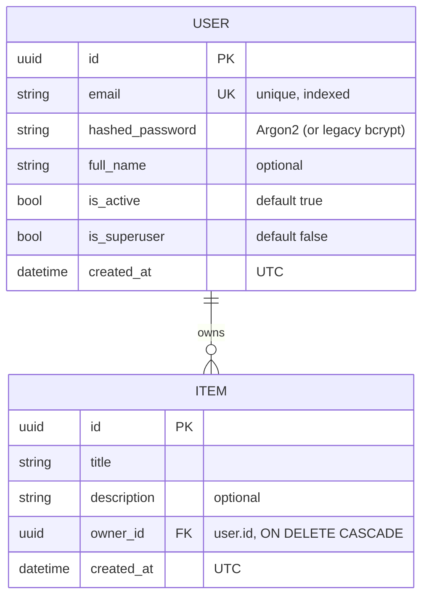
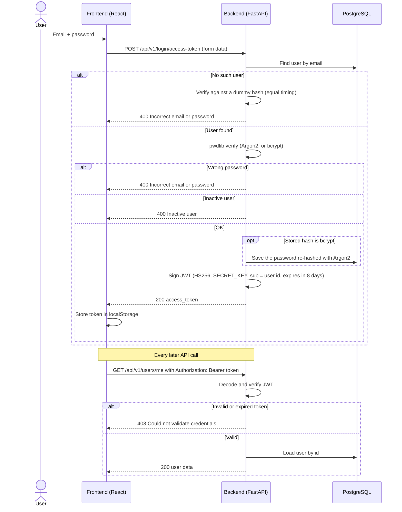
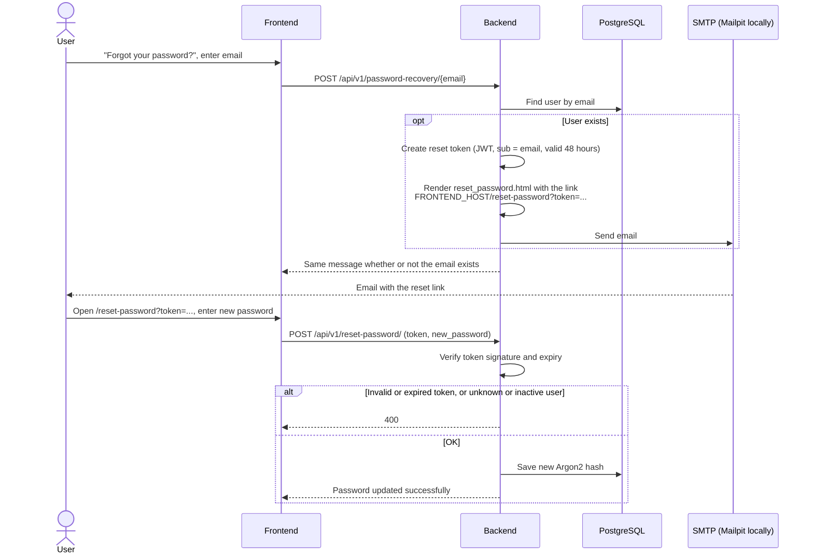
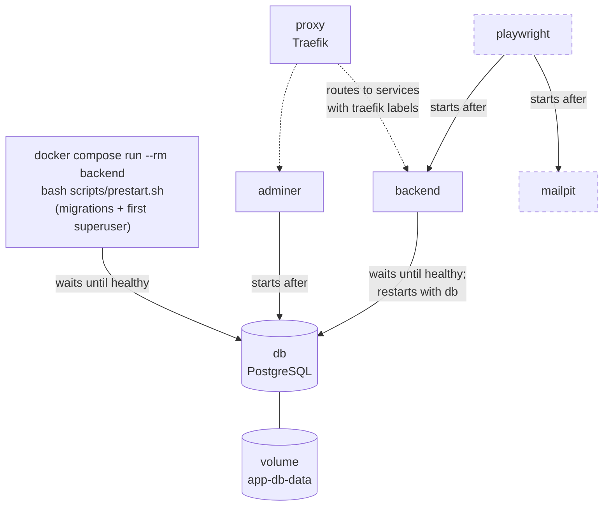
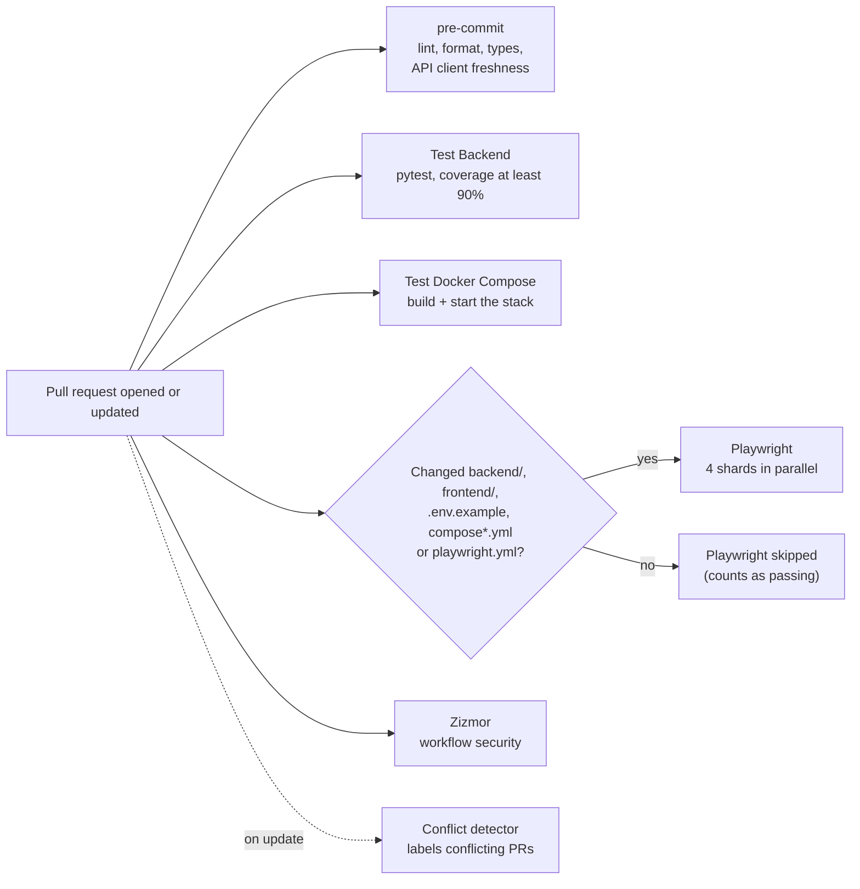
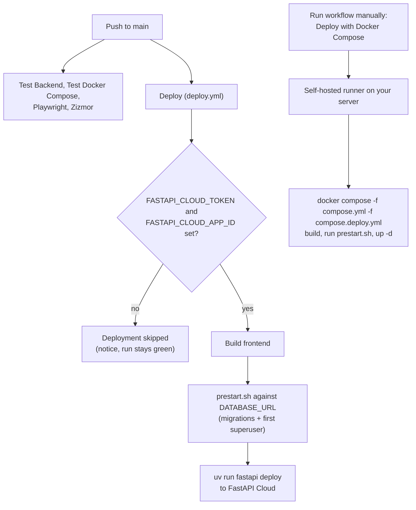
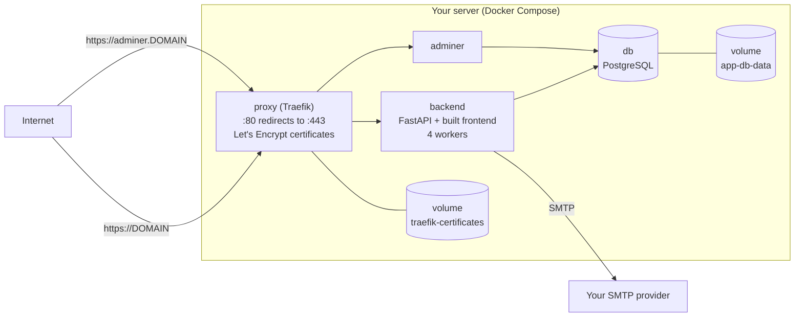
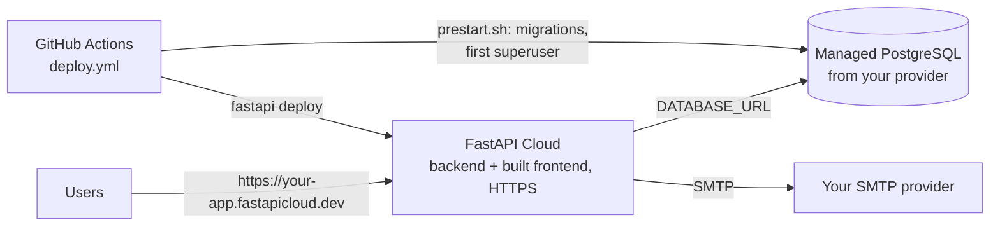
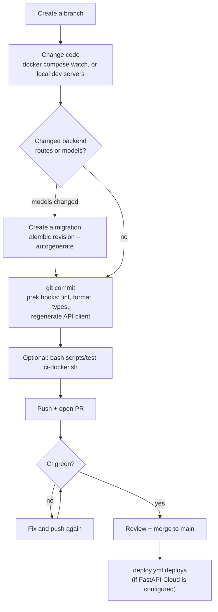

# Diagrams

Visual reference for how this application works. Each diagram describes what the code and configuration in this repository actually do, with the file each one is based on listed with it.

The service topology, request routing and email pipeline are in [ARCHITECTURE.md](../ARCHITECTURE.md), together with the explanation around them.

The diagrams are written in [Mermaid](https://mermaid.js.org), which GitHub renders automatically. To reuse one elsewhere, copy its code block into the [Mermaid Live Editor](https://mermaid.live) and export it as SVG or PNG.

## Contents

* [Database Schema](#database-schema)
* [Authentication](#authentication)
* [Docker Compose Services](#docker-compose-services)
* [CI/CD](#cicd)
* [Deployment](#deployment)
* [Development Workflow](#development-workflow)

## Database Schema

From `backend/app/models.py`. Alembic also keeps an `alembic_version` table recording the latest applied migration.

Deleting a user deletes their items. Superusers see all items; other users see only their own.

## Authentication

### Logging in and calling the API

From `backend/app/api/routes/login.py`, `backend/app/crud.py`, `backend/app/core/security.py`, `backend/app/api/deps.py` and `frontend/src/hooks/useAuth.ts`.

### Password reset

From `backend/app/api/routes/login.py` and `backend/app/utils.py`.

## Docker Compose Services

How the services depend on each other (`depends_on` in `compose.yml` and `compose.override.yml`), and the one-off preparation step. Dashed boxes exist only in local development.

Health checks: `db` runs `pg_isready`, and `backend` requests `/api/v1/utils/health-check/`. The backend's health check doesn't touch the database, so `backend` can be healthy while database queries fail.

## CI/CD

From `.github/workflows/`. Details: [ci-cd.md](./ci-cd.md).

### Pull requests

CI copies `.env.example` to `.env` and uses no repository secrets, so the same checks pass in a fresh repository and on pull requests from forks.

### Merges to `main`

The test workflows and the deploy workflow run independently. A deploy doesn't wait for the tests, so protect `main` by requiring passing checks on pull requests before merging.

## Deployment

### Your own server (`compose.deploy.yml`)

All services restart automatically (`restart: always`). Only Traefik publishes ports (80 and 443). The database isn't reachable from outside the server. Point DNS for both `DOMAIN` and `adminer.DOMAIN` at the server. Guide: [deployment-docker-compose.md](../deployment-docker-compose.md).

### FastAPI Cloud (`deploy.yml`)

The database must be reachable from GitHub's runners as well as from FastAPI Cloud, because the workflow runs the migrations itself. Guide: [deployment.md](../deployment.md).

## Development Workflow

The path a change takes, using this repository's tools.

How to create migrations: [backend/README.md](../backend/README.md).
